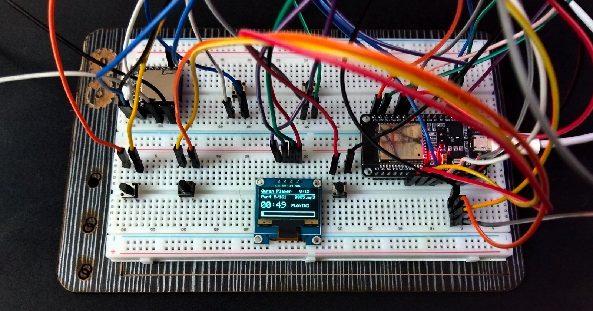
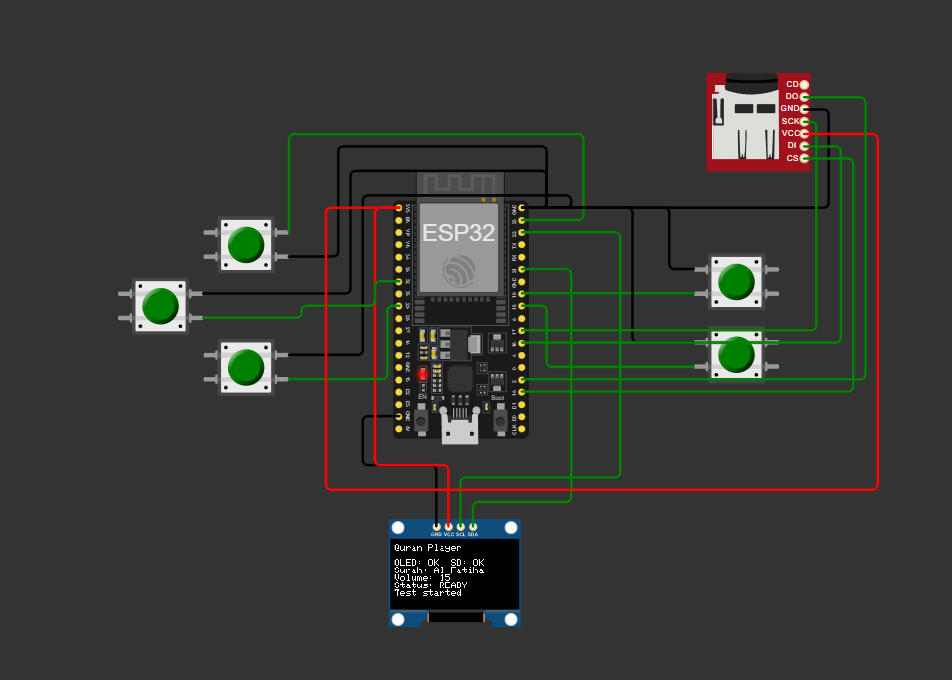

# Quran Player

A standalone Quran audio player built on an **ESP32**, a **DFPlayer Mini** and a **0.96" SSD1306 OLED**.
Audio is played from an SD card and controlled with five push buttons. The display shows the current part, elapsed time, volume and overall progress.



## Features

- Plays MP3 files from the SD card (`/MP3/0001.mp3`, `0002.mp3`, ...)
- Number of parts is **detected automatically** from the SD card
- OLED UI: part number, file name, elapsed time (mm:ss), play/pause state, volume
- Segmented progress bar, one block per part (the current part blinks)
- Previous restarts the track if more than 3 s have played, otherwise goes to the previous part
- Volume 0-30 with auto-repeat while the button is held
- Playlist wraps around after the last part
- **Bluetooth (BLE) remote control** from any phone, with live status notifications
- Software debounce on all buttons, and protection against duplicate "finished" events from the DFPlayer

## Prototype

The Quran Player circuit is currently implemented as a simulated prototype using ESP32 and Wokwi.

The prototype includes:

ESP32 microcontroller

SSD1306 OLED display (I²C)

microSD card module (SPI)

Five push buttons for navigation, volume control, and pause/resume

The simulation is used to test the circuit connections, display interface, button inputs, and microSD card initialization before physical implementation.

ESP32-based Quran Player prototype simulated in Wokwi.




## Hardware

| Component | Qty |
|---|---|
| ESP32 DevKit (esp32dev) | 1 |
| DFPlayer Mini | 1 |
| SSD1306 OLED 128x64 (I2C, address 0x3C) | 1 |
| Push buttons | 5 |
| MicroSD card (FAT32) | 1 |
| Speaker | 1 |

### Pinout

| Function | ESP32 GPIO |
|---|---|
| OLED SDA | 21 |
| OLED SCL | 22 |
| DFPlayer TX -> ESP32 RX | 27 |
| DFPlayer RX <- ESP32 TX | 26 |
| Volume Up | 18 |
| Volume Down | 19 |
| Next | 23 |
| Previous | 25 |
| Play / Pause | 32 |

Buttons use `INPUT_PULLUP`: wire each one between its GPIO and **GND**.

## SD card preparation

1. Format the card as **FAT32**.
2. Create a folder named `MP3` in the root of the card.
3. Copy the files in order, named with four digits: `0001.mp3`, `0002.mp3`, `0003.mp3`, ...

## Bluetooth control (BLE)

The player advertises as **Quran Player** using the Nordic UART Service (NUS), so no custom app is needed.
Use **nRF Connect** or **Serial Bluetooth Terminal** (select the *BLE* mode), connect, and send a command.
A small `BT` icon appears on the OLED while a phone is connected.

| Command | Action |
|---|---|
| `PLAY` / `PAUSE` / `TOGGLE` | Resume / pause / switch |
| `NEXT` / `PREV` | Next part / previous part (or restart) |
| `VOL+` / `VOL-` | Volume up / down |
| `VOL=<0-30>` | Set an exact volume, e.g. `VOL=20` |
| `TRACK=<n>` | Jump to part *n*, e.g. `TRACK=12` |
| `STATUS` | Request the current state |

The device answers with short lines such as `PLAYING 5/161 V15`, sent automatically whenever the part, state or volume changes.

| UUID | Role |
|---|---|
| `6E400001-B5A3-F393-E0A9-E50E24DCCA9E` | Service |
| `6E400002-B5A3-F393-E0A9-E50E24DCCA9E` | RX (phone writes commands) |
| `6E400003-B5A3-F393-E0A9-E50E24DCCA9E` | TX (device notifies status) |

To build without Bluetooth, set `#define ENABLE_BLE 0` at the top of `src/main.cpp`.

## Build and upload

The project uses [PlatformIO](https://platformio.org/) (VS Code extension or CLI).

```bash
git clone https://github.com/karimehab17/quran-player.git
cd quran-player
pio run -t upload     # build and flash
pio device monitor    # serial monitor @ 115200
```

If the wrong port is picked, set `upload_port` and `monitor_port` in `platformio.ini`.

## Project structure

```
quran-player/
├── src/main.cpp               # firmware
├── platformio.ini             # build configuration
├── extras/ble_power_test/     # standalone BLE / brownout test sketch
├── docs/images/               # photos, wiring diagram, simulation
└── README.md
```

## Troubleshooting

- **"DFPlayer Error" on screen**: check the TX/RX wiring (they cross over), the SD card format, and that the card is inserted.
- **Random resets / brownout** (especially when Bluetooth starts): the ESP32 and DFPlayer need a stable 5 V supply with enough current. Use a good USB cable/port, and `extras/ble_power_test` to isolate power problems. Setting `ENABLE_BLE` to 0 confirms whether BLE is the trigger.
- **Phone can't see the device**: use a BLE-capable app (nRF Connect). Classic Bluetooth scanners won't list BLE devices.
- **Wrong part count**: make sure there are no extra files inside the `MP3` folder.

